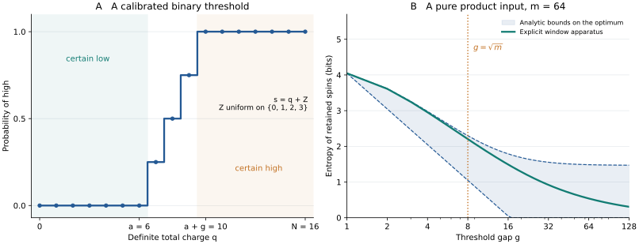

# Worked examples: a certain answer can still disturb the spins

These examples use the [model](../science/model.md) and the
[window apparatus](../science/distributed_apparatus.md). All entropies are in bits.
They explain the physical mechanism behind the [entropy law](../science/entropy_law.md).
The universal lower bound is proved in the [causal converse](../science/causal_converse.md),
and the matching construction is bounded in [window entropy](../science/window_entropy.md).

## 1. Four spins, a two-unit threshold gap

Let N=4, a=2, g=2, and let A be the first m=2 spins. The background B begins in
$`|00\rangle`$. The instrument must return low at total charges 0, 1, and 2 and
high at charge 4; charge 3 is unconstrained. Prepare

```math
|\psi\rangle=|+\rangle|+\rangle|00\rangle,
\qquad |+\rangle=\frac{|0\rangle+|1\rangle}{\sqrt2}.
```

Inside A, use $`|a_0\rangle=|00\rangle`$,
$`|a_1\rangle=(|01\rangle+|10\rangle)/\sqrt2`$, and
$`|a_2\rangle=|11\rangle`$. The input is a coherent superposition of these
three orthogonal charge states, with probabilities 1/4, 1/2, and 1/4. Every
occupied charge lies in the low region, so the correct binary answer is certain.

The length-two window pointers are

```math
|e_0\rangle=\frac{|0\rangle+|1\rangle}{\sqrt2},\qquad
|e_1\rangle=\frac{|1\rangle+|2\rangle}{\sqrt2},\qquad
|e_2\rangle=\frac{|2\rangle+|3\rangle}{\sqrt2}.
```

Neighboring windows overlap by 1/2, whereas the first and third are orthogonal.
The system's charge-0/charge-2 coherence disappears, and each neighboring
coherence is multiplied by 1/2. The normalized vector inside the charge-1
sector is preserved: the apparatus has not measured which of the first two
spins was occupied.

The weighted Gram matrix is

```math
G_{qr}=\sqrt{p_qp_r}\langle e_r|e_q\rangle,
\qquad
G=\begin{pmatrix}
1/4&1/(4\sqrt2)&0\\
1/(4\sqrt2)&1/2&1/(4\sqrt2)\\
0&1/(4\sqrt2)&1/4
\end{pmatrix}.
```

Its eigenvalues are $`(3+\sqrt5)/8`$, $`1/4`$, and $`(3-\sqrt5)/8`$.
Thus the retained spins have positive entropy although the reported low/high
bit has entropy zero. In this example the window entropy is approximately
1.224 bits. The universal product-state converse is 0.5 bits, because
$`H(1/4,1/2,1/4)-\log_2 2=1/2`$. The example evaluates a specific instrument;
it does not identify the exact minimum for these parameters.

## 2. Why causality constrains an input far below the threshold

Keep the same four-spin parameters and consider the active superposition
$`(|00\rangle+|11\rangle)/\sqrt2`$. With B in $`|00\rangle`$, its two global
charges are 0 and 2, both low. With B changed to $`|11\rangle`$, the charges
become 2 and 4, which must give opposite answers.

An ideal binary projection with high projector $`\Pi_4`$ preserves the active
coherence in the first background and removes it in the second. The reduced
active output would reveal the background choice. That binary projection
therefore fails the nonsignalling requirement on the retained spins.

A causal instrument must already remove the relevant active coherence in the
first background. This is why calibration elsewhere in the Hilbert space
constrains disturbance on an input whose own answer is certain. The argument
uses preservation of sector states as well as calibration; the
[causal comparison proof](../science/causal_converse.md) spells out both ingredients.

## 3. Fine readout, binary readout, and entropy

For the first example the fine position record s has distribution

```math
\Pr(s=0,1,2,3)=(1/8,3/8,3/8,1/8).
```

All these records are grouped into the same low answer because high begins at
s=a+g=4. Nevertheless, the different fine records leave different conditional
spin states. When only the binary answer is retained, those states are mixed.
The apparatus's fine record has not been coherently erased.

Three entropies therefore describe different things:

| Quantity | What it measures in this example |
|---|---|
| Entropy of the binary answer | Zero, because the answer is always low |
| Entropy of the fine classical record s | The uncertainty after measuring the pointer position |
| Entropy of the unconditioned retained spins | The entropy of the coherent pointer mixture, given by G |

Position measurement can increase the pointer's entropy. The system entropy
is not obtained by simply counting fine outcomes or substituting H(s).
The [Fourier entropy proof](../science/window_entropy.md) quantifies how much coherence
the translated windows retain.

## 4. Product fluctuations and the scale of the gap

For m active spins in $`|+\rangle^{\otimes m}`$, the charge distribution is
binomial with variance m/4. A gap much smaller than its width leaves many
distinguishable coarse-charge possibilities. The optimal entropy cost is

```math
\log_2\!\left(1+\frac{\sqrt m}{g}\right)+O(1),
```

where the error is an additive constant independent of m and g. The
[product-corollary proof](../science/fluctuation_regimes.md) gives the finite bounds.
When the gap is much wider than the fluctuations, the separate common-core
and concentration arguments in that document prove that the explicit
apparatus's entropy tends to zero. An additive constant bound alone would not
establish that limit.



**Figure.** Panel A shows the exactly calibrated window threshold for N=16,
a=6, g=4. Panel B fixes m=64, a=64, N=192 and varies g from 1 to 128, so every
point satisfies the theorem's integer conditions and the input always lies in
the low region. The green curve is the explicit window entropy. The shaded
interval uses the analytic product lower bound and variance upper bound; it is
not a numerical optimization over instruments. The orange line marks g=√m.
The nonzero limiting value of the displayed variance bound does not contradict
the separately proved vanishing limit. [Reproduction](../verification/README.md).

## 5. Two exact boundaries

For g=1 and the theorem's active-input family with vacuum spectators, all
distinct supported charge pointers are orthogonal. Every admissible exact
instrument therefore produces entropy exactly H(Q).
For an equal superposition of M charge states spaced by g, the window pointers
are also pairwise orthogonal and the entropy is exactly log₂M. Both examples
give equality, beyond the general constant-accuracy statement.

The bin convention itself has a boundary effect. Place equal probability at
q=g−1 and q=g. The variable floor(Q/g) has entropy one bit, but the two windows
overlap by 1−1/g. The window entropy is

```math
h_2\!\left(\frac1{2g}\right)\longrightarrow0.
```

For example, a=g, m=g, and N=2g provide valid ambient parameters. This case
explains why a universal assertion of exact equality to the chosen coarse-bin
entropy would be false. These boundaries are stated in the
[entropy law](../science/entropy_law.md).

## 6. Why the assumptions matter

**Sector preservation.** If this is removed, one may read the threshold and
reset all retained spins to a fixed pure state. The nonselective retained
channel is then constant and causal, while its output entropy is zero. Such
an operation destroys the input inside its charge sectors and is excluded by
the theorem.

**Pure input.** The charge-diagonal mixture
$`\sum_qp_q|a_q0\rangle\langle a_q0|`$ is already mixed. An exact-preserving
instrument leaves it unchanged, so its charge uncertainty is not newly created
entropy. The theorem's entropy cost refers to initially pure coherent inputs.

**Ordered threshold.** The sharp parity observable
$`P=\bigotimes_j Z_j`$ has the causal nonselective channel
$`\rho\mapsto(\rho+P\rho P)/2`$. On a pure input its output rank is at most two
and its entropy is at most one bit. Thus binary nonlocality alone does not force
the threshold law. Ordered charge calibration is part of the mechanism; the
[interpretation](../science/interpretation.md) develops this comparison.

**Robust preparation phases.** With exact sector preservation, common input
phases do not change the output entropy. For general imperfect preservation,
the robust theorem uses an average over a specified phase family. Keep the
phase index: averaging output entropies is different from forgetting which
pure input was prepared. See [robustness](../science/robustness.md).
