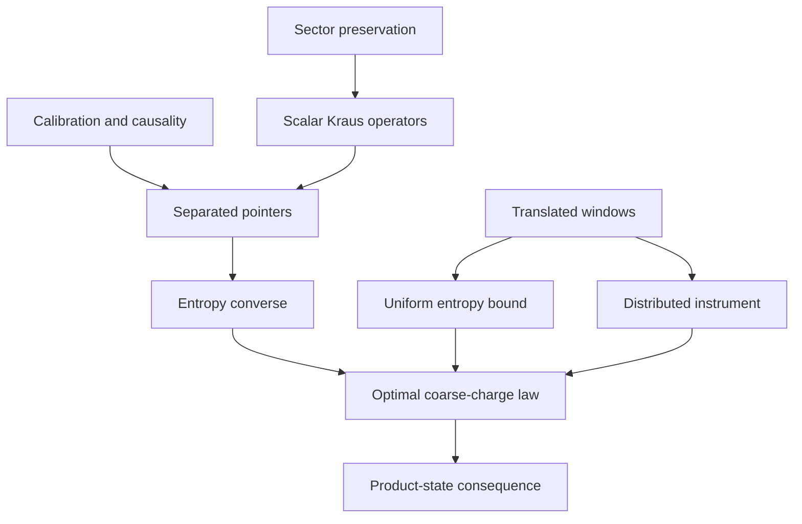

# Proof map

Read [MODEL](MODEL.md) for the operational class and notation, then
[THEOREM](THEOREM.md) for the exact finite statements. The diagram organizes
logical dependencies; the table locates the complete arguments.

## Exact theorem

| Argument | What it establishes | Full derivation |
|---|---|---|
| Pure-state preservation and linearity | Every Kraus operator is scalar on each global charge sector | [EXACT_PROOFS](EXACT_PROOFS.md) |
| Background charge shift | Active-input pointers at q,r in 0,…,m separated by at least g are orthogonal | [EXACT_PROOFS](EXACT_PROOFS.md) |
| Bins grouped by parity | Output entropy is at least H(J)−H(J mod 2) | [EXACT_PROOFS](EXACT_PROOFS.md) |
| Translated window overlap | An admissible kernel with exact gap-dependent coherence loss | [APPARATUS](APPARATUS.md) |
| All-record Fourier calculation | The full fine and binary instruments follow from local probe readouts | [APPARATUS](APPARATUS.md) |
| Fourier dephasing and data processing | S(window mixture) ≤ H(Q+Z)−log₂g+Cg | [EXACT_PROOFS](EXACT_PROOFS.md) |
| Fejér integral | A dimension-independent, explicitly evaluated constant | [EXACT_PROOFS](EXACT_PROOFS.md) |
| Entropy of bin mixtures | The upper bound H(J)+log₂(2−1/g)+Cg | [EXACT_PROOFS](EXACT_PROOFS.md) |
| Residue classes and binomial entropy | The product-state lower bound H(Bin(m,1/2))−log₂g | [EXACT_PROOFS](EXACT_PROOFS.md) |
| Discrete variance entropy bound | The explicit product-state upper bound and uniform logarithmic envelope | [EXACT_PROOFS](EXACT_PROOFS.md) |
| Common-core pinching and concentration | Vanishing window entropy when the gap dominates the charge fluctuations | [EXACT_PROOFS](EXACT_PROOFS.md) |

The exact lower bound needs one direction of nonsignalling on one specified
cut. The construction obeys the stronger condition on every cut. Its existence
proves that the admissible class is nonempty and supplies the upper bound for
all priors with one apparatus.

## Robust theorem

All robust steps are in [ROBUSTNESS](ROBUSTNESS.md). They start from selected
baseline-state survival, not from an approximate scalar-Kraus assertion.

| Argument | Role |
|---|---|
| Common Stinespring dilation of the active marginal | Moves a change of background into the complementary output |
| Survival-conditioned pointers and calibration | Provides alternative noisy threshold decoders on one encoded ensemble |
| Serial information accounting | Converts decoder performance into pointer entropy |
| Fourier-family entropy transfer | Converts pointer entropy into average retained-system entropy without an ambient-dimension penalty |
| Exact-readout compression bound | Improves the coefficient when readout and nonsignalling are exact |
| Continuity of Stinespring dilation | Extends decoder control to a full-diamond causality defect |

The comparison decoders are alternative measurements used in an information
argument. The proof does not repeatedly interrogate one physical copy. The
Fourier family is a preparation ensemble whose index is retained; the lower
bound concerns the average of the individual output entropies.

## Evidence and attribution

[VERIFICATION](../VERIFICATION.md) documents independent finite-matrix checks
and reproducible examples. They test the implementation and analytic formulas;
they are not a substitute for the quantifiers in the proofs.
[ATTRIBUTION](../literature/ATTRIBUTION.md) identifies the imported mathematical
tools and close physical precedents. The [learning route](../docs/LEARNING.md)
provides a separate conceptual path into these same statements.
